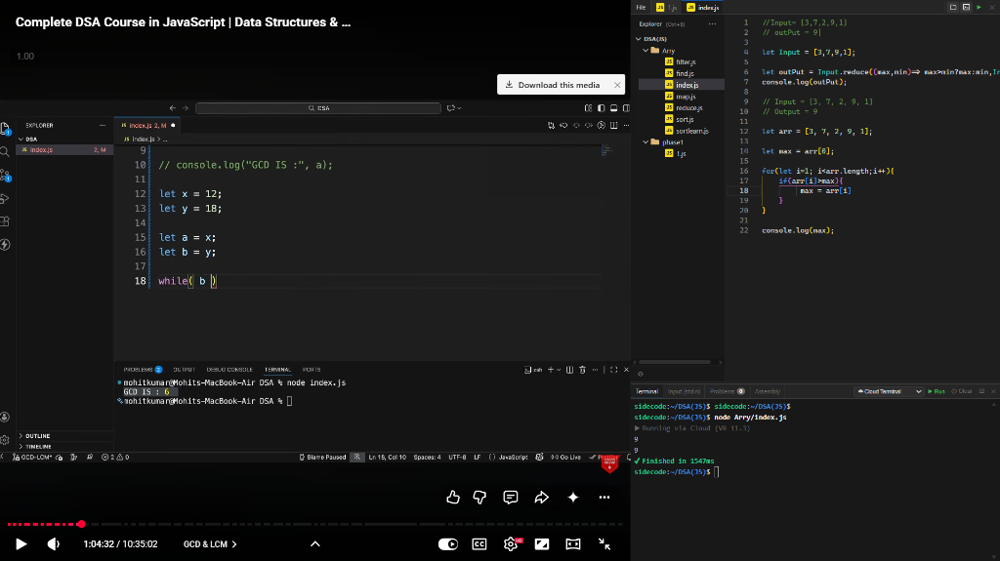
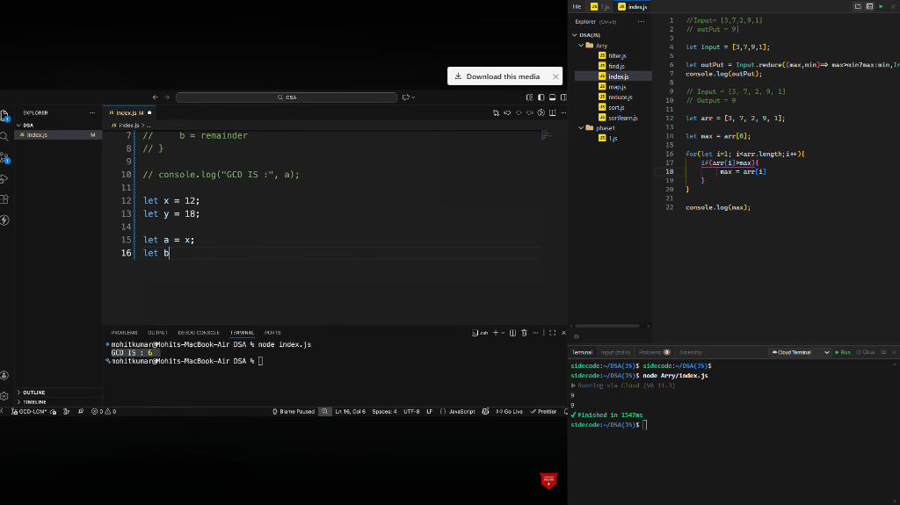
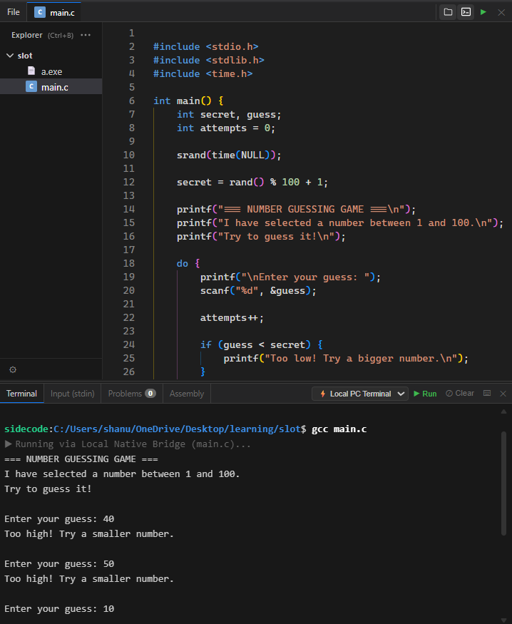
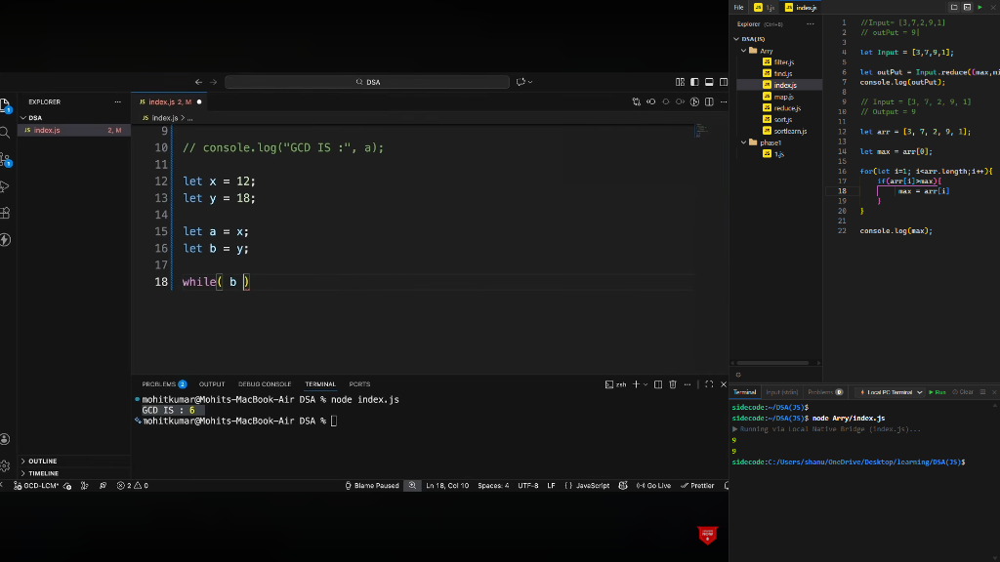
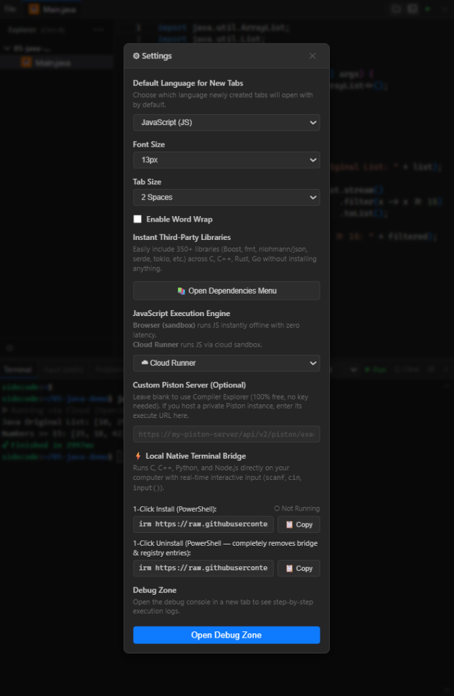

# Sidecode: VS Code-Style IDE in Your Browser Side Panel

<div align="center">

[](https://github.com/UTKARSHKUMAR712/Sidecode/releases)
[](https://github.com/UTKARSHKUMAR712)
[](https://opensource.org/licenses/MIT)
[](https://developer.chrome.com/docs/extensions/mv3/intro/)
[](https://github.com/UTKARSHKUMAR712/Sidecode)

<br/>

**A lightweight, ultra-fast, Monaco-powered Integrated Development Environment that lives directly inside your browser's side panel (Chrome, Brave, Edge).**

Write, edit real PC files, compile multi-file projects, run an interactive terminal, and execute code in multiple languages without ever leaving your active web tab.

*Crafted with ❤️ by **[utkarshkumar712](https://github.com/UTKARSHKUMAR712)***

</div>

---

## 📸 Screenshots & Live Demos

Experience how **Sidecode** changes the way you learn, build, and debug code right alongside your browser tabs:

### 1. 📺 Split-Screen Coding Alongside YouTube Tutorials & Documentation
> Code along with YouTube video lectures, documentation, or LeetCode problems side-by-side without ever switching windows or resizing desktop apps.

<div align="center">
  
</div>

<br/>

### 2. ☁️ Instant Cloud Compilation for Data Structures & Algorithms
> Zero setup required! Compile C, C++, and Python with GCC 14.1 / Clang in isolated cloud sandboxes while watching computer science tutorials.

<div align="center">
  
</div>

<br/>

### 3. 🎯 Authentic Real-Time Interactive Terminal (`scanf` & `cin` Live Loops)
> Truly bidirectional standard input! Play interactive C number-guessing games, test algorithms, and provide runtime inputs step-by-step just like a native desktop terminal.

<div align="center">
  
</div>

<br/>

### 4. ⚡ Local Native PC Terminal Bridge (Direct Toolchains on Real PC Folders)
> Connect directly to your local PC compilers (MSYS2 GCC, Clang, Node.js, Python, Rust, Go) to build and run actual project files on your disk.

<div align="center">
  
</div>

<br/>

### 5. ⚙️ Streamlined Preferences & 1-Click Bridge Setup
> Clean, intuitive settings modal featuring one-click copy buttons for bridge installation and complete uninstallation.

<div align="center">
  
</div>

---

## 💻 Supported Programming Languages & Execution Engines

Sidecode provides native syntax highlighting, auto-detection, code formatting, IntelliSense, and compilation/execution across major programming languages:

| Language | File Extensions | Execution Mode | Capabilities & Features |
| :--- | :--- | :--- | :--- |
| **C** | `.c` | Cloud (GCC 14.1 / Clang) & Local Bridge | C99, C11, C17, C23, full `stdio`, `stdlib`, `math`, multi-file headers |
| **C++** | `.cpp`, `.cc`, `.cxx`, `.h`, `.hpp` | Cloud (GCC 14.1 / Clang) & Local Bridge | C++17, C++20, C++23, 350+ pre-compiled libraries (Boost, fmt, nlohmann/json, Catch2) |
| **Python** | `.py` | Cloud (Python 3.12+) & Local Bridge | Python 3 standard library, math, sys, script execution |
| **JavaScript** | `.js`, `.mjs`, `.cjs` | 100% In-Browser Sandbox (Offline) & Node.js | ES2024, directory-aware CommonJS `require()` resolution, nested files |
| **TypeScript** | `.ts` | In-Browser Sandbox (Offline) | Full TypeScript syntax, type safety diagnostics, 0ms network latency |
| **Rust** | `.rs` | Cloud (Rustc 1.80+) & Local Bridge | Rust 2021 edition, memory safety diagnostics, standard library |
| **Go** | `.go` | Cloud (Go 1.22+) & Local Bridge | Go 1.22+ standard library, goroutines, instant formatting |
| **Java** | `.java` | Cloud (OpenJDK 21+) & Local Bridge | Modern OpenJDK 21, object-oriented compilation |
| **Web & Markup** | `.html`, `.css`, `.scss`, `.json`, `.md`, `.yaml`, `.xml`, `.sql`, `.sh` | Monaco Editor Formatters | Bracket matching, auto-indentation, syntax highlighting, code folding |

---

## 🌟 Key Features

### 🖥️ 1. Complete VS Code Look & Feel
- **Full Menu Bar:** Top-level dropdown menu (`File` > `New File`, `Open File...`, `Open Folder...`, `Toggle Explorer`, `Toggle Terminal / Console`, `Save`, `Save As...`, `Auto Save`, `Close Editor`, `Close Folder`, `Keyboard Shortcuts`, `Preferences: Settings`).
- **Top Nav Bar Quick-Action Buttons:** Dedicated 1-click icon buttons to toggle the **Explorer (`Ctrl+B`)** and **Terminal / Console (`Ctrl+` `)** with real-time active state highlights.
- **Collapsible File Explorer (`Ctrl+B`):** Full tree hierarchy with custom file icons (JS, TS, C++, Rust, Python, Go, Java, JSON, etc.), collapsible directories, horizontal side-scrolling for deep folder trees, and right-click context actions.
- **Direct PC Disk Editing:** Uses the native **File System Access API** (`showDirectoryPicker`) to edit actual project files on your hard drive in place. No import/export hurdles.
- **IndexedDB Workspace Persistence:** Automatically restores your last opened workspace directory and open file tabs across browser restarts without creating boilerplate untitled scratchpads.
- **Double-Click Creation:** Double-click empty workspace space to quickly create files or folders, just like in desktop VS Code.
- **Interactive Keyboard Shortcuts Reference (`Ctrl+K Ctrl+S` / `F1`):** Complete on-screen cheat sheet accessible via File menu, console header button (`⌨`), or keyboard shortcut.

### 💻 2. Interactive Terminal CLI
- **Real-Time Shell Environment:** Type shell commands directly into the terminal prompt.
- **Built-in Commands:**
  - `cd <dir>` — Navigate directories (`cd ..`, `cd ~`, `cd folder`).
  - `mkdir <name>` — Create folders on disk.
  - `touch <name>` — Create files on disk.
  - `rm [-r] <name>` — Delete files or directories.
  - `mv <src> <dest>` — Rename or move files and folders.
  - `ls` / `dir` — List directory contents with folder icons.
  - `pwd` — Print current working directory path.
  - `cat <file>` — Display file contents.
  - `shortcuts` — Display the full cheat sheet of all Sidecode keyboard shortcuts.
  - `node <file.js>` / `python <file.py>` / `g++ <file.cpp>` — Run scripts or compile code from the prompt.
  - `clear` / `cls` — Clear terminal screen.
  - **Direct Expression Evaluation:** Type JS or math expressions directly into the prompt (e.g. `[5, 12, 8].filter(x => x > 10)`).
- **Prompt Synchronization:** Displays your active workspace and current relative working directory (`sidecode:~/workspace/src$`).

### ⚡ 3. Multi-Model Monaco Editor
- **Industry-Standard Editing:** Powered by Monaco Editor (the core of VS Code) with syntax highlighting, bracket matching, code folding, word wrap, and customizable font size and tab size.
- **Auto Language Detection:** Automatically associates Monaco language modes, IntelliSense, and compilation tools based on file extensions (`.js`, `.ts`, `.py`, `.cpp`, `.c`, `.rs`, `.go`, `.java`, etc.).
- **Multi-Tab Lifecycle:** Switch effortlessly between open files with view state persistence (scroll position and cursor position are saved when switching tabs).
- **Dirty State Tracking (`●`):** Unsaved changes display a dirty bullet indicator on tab headers and tree items, with unsaved change safeguards when closing.

### 🚀 4. Hybrid Execution Engine (Cloud, Local PC, Browser Sandbox)
- **Single Unified Environment Selector (In Console Header):**
  - **`☁ Cloud Terminal` (Default):** Zero setup! Executes code instantly in cloud compiler environments (GCC 14.1, Clang, Python 3.12+, OpenJDK 21, Rust 1.80, Go 1.22). No local compilers needed.
  - **`⚡ Local PC Terminal`:** Connects directly to your local computer's toolchains (MSYS2 GCC, Clang, Python, Node.js, Rust, Go) with real-time interactive terminal input (`scanf`/`cin` live loop).
  - **`💻 Browser Sandbox`:** 100% offline in-browser sandbox with 0ms network latency for JavaScript and TypeScript.
- **Local Native Bridge Setup (1-Click Install & Uninstall):**
  - **Install (One-line PowerShell command from any terminal):**
    ```powershell
    irm https://raw.githubusercontent.com/UTKARSHKUMAR712/Sidecode/main/install-bridge.ps1 | iex
    ```
  - **Uninstall (One-line PowerShell command to completely remove):**
    ```powershell
    irm https://raw.githubusercontent.com/UTKARSHKUMAR712/Sidecode/main/uninstall-bridge.ps1 | iex
    ```
  - **Manual Start (Folder double-click or CLI):**
    - Double-click `start-bridge-silent.vbs` to start 100% silently in the background with zero CMD popups.
    - Or double-click `start-bridge.cmd` (or run `node bridge.js` in your terminal) to see live terminal logs.
    - Double-click `uninstall-bridge.cmd` to completely remove and stop the bridge.
  - **Clean Terminal Auto-Setup:**
    - When switching to **`⚡ Local PC Terminal`**, the terminal immediately runs a clean clear command and connects to your local folder.
    - If you see `⚠ Local PC Bridge not running on port 3888`, run the 1-click installer above or double-click `start-bridge-silent.vbs`.
    - You can switch back to **`☁ Cloud Terminal`** anytime in the dropdown for instant free cloud execution without any local tools.
  - **100% Silent Background Operation:** Runs invisibly in the background with zero flashing console windows.
  - **Auto-Close Safeguards:** Terminates automatically whenever you close the extension side panel or exit your browser.
  - **Authentic Step-by-Step Interactive I/O:** Truly real-time bidirectional standard input (`scanf`, `cin`, `input()`). Loops pause live between iterations and accept inputs interactively just like native VS Code terminal.
  - **Zero npm Dependencies:** Built purely using standard Node.js libraries (`node:http`, `node:child_process`).
- **In-Browser Sandbox (100% Offline):**
  - **Languages:** JavaScript, TypeScript.
  - Runs in a secure, isolated browser sandbox. Instant execution with 0ms network latency.
  - Full support for modern ECMAScript, formatted object/array inspection, and error stacks.
- **Cloud Runner (Compiler Explorer / Piston — Fallback):**
  - **Languages:** C, C++, Python, Java, Rust, Go.
  - Executes code via Compiler Explorer in isolated Docker nsjail containers with standard library support.
  - **Unified Array & Object Output:** Harmonized standalone Google V8 (`d8`) output so array filtering and object logs match Node.js and browser formatting (`[ 12, 20, 15 ]`).
  - **Custom Piston Endpoint:** Option to configure a self-hosted Piston execution server in Settings.

### 🛠️ 5. Developer Tools & Productivity
- **Strict Input (`stdin`) Parser:** Supply batch standard input for interactive prompts (`scanf`, `cin`, `input()`). Includes strict data typing for strings, booleans, and arrays.
- **Problems Panel & Clean Diagnostics:** Isolates compilation errors and warnings from program output. Clicking any problem immediately navigates and highlights the exact line and column in the editor.
- **Assembly Inspector:** Real-time disassembly viewer displaying compiler-generated machine instructions mapped to source code lines.
- **Instant Libraries (Dependencies Menu):** Link 350+ pre-compiled libraries (Boost, fmt, nlohmann/json, Catch2, Tokio, Serde, etc.) with a single click.
- **Document Formatting (`Ctrl+Alt+F`):** Format code on-demand via Monaco's built-in formatters and language formatters.
- **Debug Zone:** Dedicated diagnostics dashboard to inspect extension memory usage, API requests, and execution telemetry.

---

## ⌨️ Keyboard Shortcuts

| Shortcut | Action | Scope / Context |
| :--- | :--- | :--- |
| `Ctrl + B` | **Toggle File Explorer sidebar** | Global |
| `Ctrl + \`` / `Ctrl + ~` | **Toggle Terminal / Console panel** | Global |
| `Ctrl + K Ctrl + S` / `F1` | **Open Keyboard Shortcuts Reference modal** | Global |
| `Ctrl + Enter` | **Run code** (via Cloud, Local PC, or Browser Sandbox) | Global |
| `Ctrl + N` / `Ctrl + T` | **New file / tab** | Global |
| `Ctrl + O` | **Open file from disk** | Global |
| `Ctrl + K Ctrl + O` | **Open folder from disk** (File System Access API) | Global |
| `Ctrl + S` | **Save active file directly to disk** | Editor |
| `Ctrl + Shift + S` | **Save As...** (choose destination on PC) | Editor |
| `Ctrl + W` | **Close active tab** | Editor / Tabs |
| `Ctrl + 1 ... 9` | **Switch between open tabs 1 to 9** | Global |
| `Ctrl + Alt + F` | **Format Document** | Editor |
| `Ctrl + Alt + A` | **Run Static Code Analysis** on active file | Editor |
| `Ctrl + ,` | **Open Settings & Preferences** | Global |
| `Ctrl + Shift + Z` | **Close / Toggle Sidecode panel** | Global |
| `shortcuts` (CLI command) | **Show all shortcuts in terminal output** | Terminal |

---

## 📁 Project Structure

```text
Sidecode/
├── manifest.json              # Chrome Extension Manifest V3 configuration (utkarshkumar712)
├── background.js              # Service worker managing side panel behavior
├── bridge.js                  # Native PC execution micro-bridge (HTTP + SSE on port 3888)
├── install-bridge.ps1         # 1-Click PowerShell installer for local bridge
├── uninstall-bridge.ps1       # 1-Click PowerShell uninstaller for local bridge
├── start-bridge-silent.vbs    # Background runner with zero flashing CMD windows
├── package-extension.ps1      # Automated production extension packager
├── llms.txt                   # Standard specification for AI agents and LLM crawlers
├── llms-full.txt              # Comprehensive technical API documentation for AI indexing
├── CITATION.cff               # Official citation metadata crediting utkarshkumar712
├── SECURITY.md                # Security policy & vulnerability reporting
├── CONTRIBUTING.md            # Guidelines for open-source contributors
├── sidepanel/
│   ├── index.html             # Main IDE DOM layout
│   ├── app.js                 # Central application controller & event wiring
│   ├── style.css              # VS Code dark theme styling & responsive layout
│   ├── sandbox.html           # Isolated offline iframe sandbox for JS/TS
│   ├── storage.js             # Chrome storage & IndexedDB persistence
│   ├── modules/
│   │   ├── editor.js          # Monaco editor instance & multi-model manager
│   │   ├── explorer.js        # File tree explorer UI, context menus, and CRUD
│   │   ├── workspace.js       # File System Access API & disk synchronization
│   │   ├── terminal.js        # Interactive terminal CLI & command dispatcher
│   │   ├── tabs.js            # Tab bar state, lifecycle, and dirty flags
│   │   ├── cloudRunner.js     # Compiler Explorer & cloud execution engine
│   │   ├── analysis.js        # Problems panel & diagnostic parser
│   │   ├── console.js         # Terminal output stream, stdin, & assembly panel
│   │   ├── libraries.js       # Third-party dependency search & injection
│   │   ├── multifileCompiler.js # Multi-file compilation payload builder
│   │   ├── completions.js     # Code autocompletion dictionaries
│   │   └── permissions.js     # Brave & Chrome permission helpers
│   ├── vs/                    # Monaco Editor core distribution
│   └── workers/               # Monaco Editor web workers
├── debug/                     # Sidecode Debug Zone dashboard
└── docs/                      # Technical architecture documentation & screenshots
    └── screenshots/           # High-resolution IDE demonstration screenshots
```

---

## 📥 Installation (Developer Mode)

1. Clone or download this repository to your computer:
   ```bash
   git clone https://github.com/UTKARSHKUMAR712/Sidecode.git
   ```
2. Open **Google Chrome**, **Brave Browser**, or **Microsoft Edge**.
3. Navigate to extensions settings:
   - Chrome: `chrome://extensions/`
   - Brave: `brave://extensions/`
   - Edge: `edge://extensions/`
4. Toggle **Developer mode** in the top right corner.
5. Click **Load unpacked** and select the root `Sidecode` folder (where `manifest.json` is located).
6. Pin **Sidecode** to your browser toolbar.
7. Click the extension icon (or press `Ctrl+Shift+Z`) to launch the IDE in your browser side panel.

---

## 🔒 Security & Privacy

- **Offline Safety:** All JavaScript and TypeScript executions run locally in your browser's sandboxed iframe without transmitting code over the network.
- **Local Disk Privacy:** Files accessed via Open Folder remain on your local machine; only the files you explicitly execute via Cloud Runner are transmitted over HTTPS to isolated sandbox runners.
- **No Telemetry / No Tracking:** Sidecode does not collect personal data, track user keystrokes, or display advertisements.

---

## 🔍 Search Engine & AI Indexing Keywords

To ensure search engines (Google, Bing, DuckDuckGo) and AI crawlers (ChatGPT, Perplexity, Claude, Copilot, Cursor) accurately categorize this repository and connect it across author projects:

- **Author Signature:** `utkarshkumar712` | `Utkarsh Kumar`
- **Core Technology:** `Sidecode`, `Monaco Editor`, `Chrome Extension Side Panel`, `Brave Browser Side Panel`, `VS Code in Browser`, `Manifest V3`.
- **Target Search Queries:**
  - *Browser side panel code editor*
  - *Code editor for YouTube tutorials split screen*
  - *Run C C++ programs in browser side panel*
  - *Interactive C scanf terminal in Chrome*
  - *VS Code side panel extension for Chrome and Brave*
  - *Direct PC folder editing in browser with File System Access API*
  - *Compiler Explorer Monaco editor side panel*
  - *Local terminal execution bridge for browser extensions*

---

## 👨‍💻 Author & Connect

**Sidecode** is created and actively maintained by **[utkarshkumar712](https://github.com/UTKARSHKUMAR712)**.

- **GitHub Profile:** [@UTKARSHKUMAR712](https://github.com/UTKARSHKUMAR712)
- **Repository:** [https://github.com/UTKARSHKUMAR712/Sidecode](https://github.com/UTKARSHKUMAR712/Sidecode)
- **Issue Tracker:** [Report a Bug or Request a Feature](https://github.com/UTKARSHKUMAR712/Sidecode/issues)

If you find Sidecode helpful, give it a ⭐ on GitHub and share it with your fellow developers!
